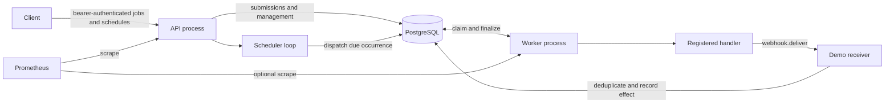
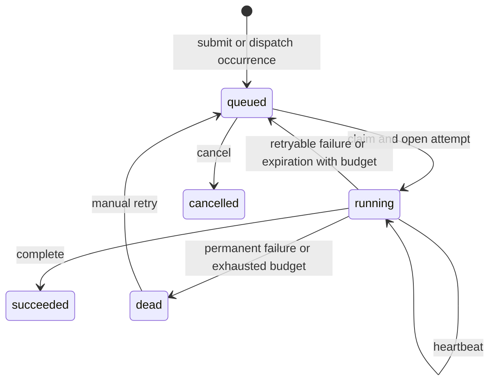
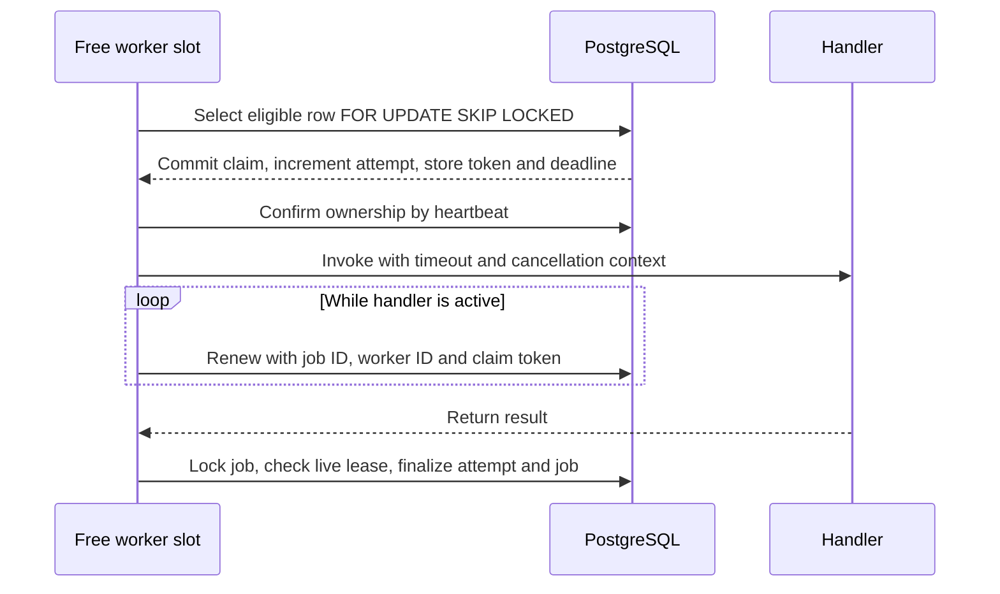
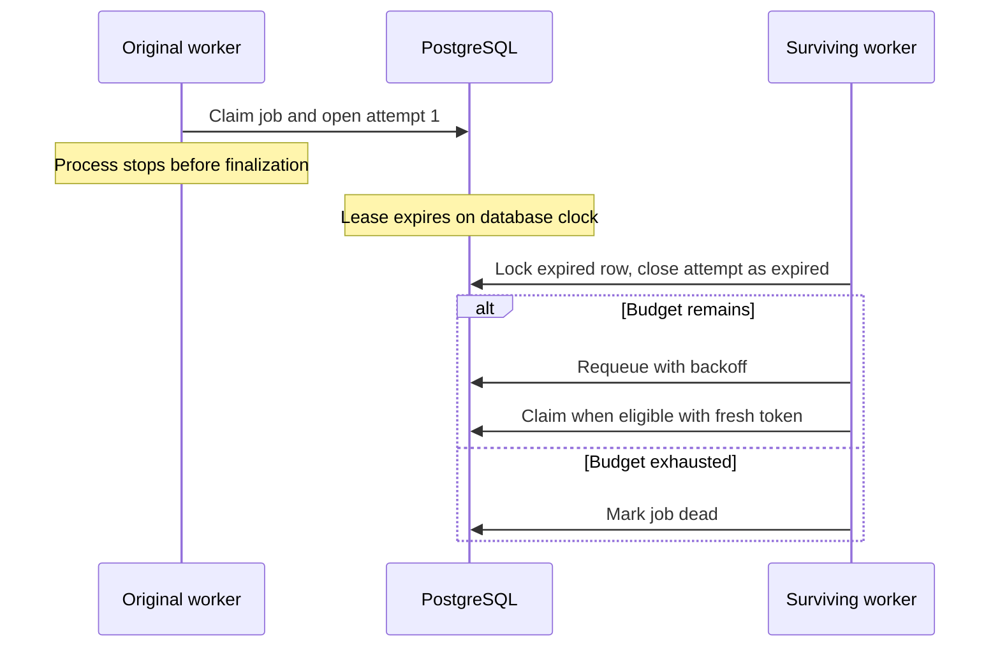
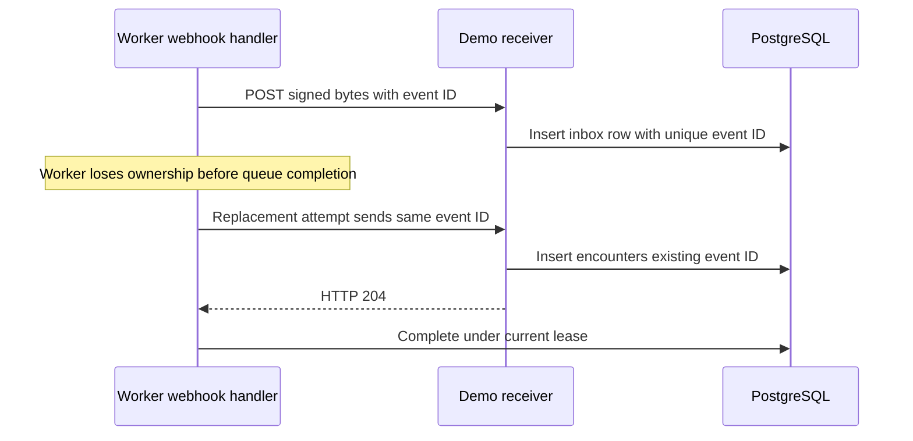

# Architecture

PostgreSQL owns the state of every job. The API accepts submissions, supports inspection and guarded management transitions, and runs one scheduler loop per process. A cron occurrence enters the same jobs table as an immediate submission. Independent workers claim jobs only when a local execution slot is free. See the [system diagram](../README.md) and [deployment topology](DEPLOYMENT.md).

## Job lifecycle

Delayed jobs stay queued until available_at. The job row shows current state; each claim inserts a numbered attempt with its own worker and token. Completion, failure and recovery finalize the open attempt in the same transaction as the state change. Manual retry increases the maximum budget by one and preserves attempt numbers.

## Claim and renew

The handler runs outside a database transaction. A lost or uncertain renewal cancels its context. A handler that ignores cancellation may continue performing external work. The database still fences stale finalization.

## Recovery after a crash

Each worker also runs a periodic reaper. Multiple reapers can skip one another's locks. Graceful shutdown stops claiming, lets handlers drain with heartbeats, and cancels remaining work after the configured grace period.

## Webhook redelivery

The sender resolves an operator-configured destination. The receiver verifies the timestamp and signature before inserting its business effect. The queue and receiver use distinct tables; the HTTP acknowledgment and job completion are separate commits.

## Monitoring

The API and each worker own separate Prometheus registries. The API also reads current job counts from PostgreSQL during a scrape. Aggregate process counter rates across instances. Use one database-wide depth measurement per queue. Scraping frequency affects database load. [Metrics and queries](OBSERVABILITY.md)
