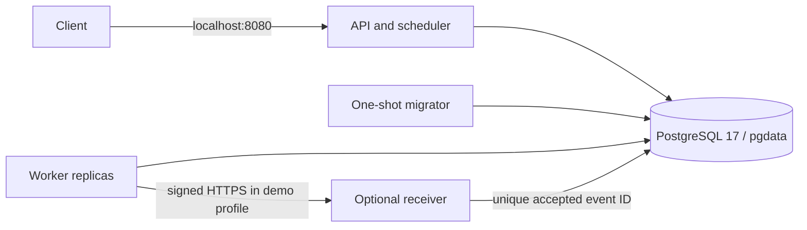

# Running Relay with Docker

The default stack requires Docker with Compose and an explicit API key. PostgreSQL, the migration client, the API and the worker run in containers. Make provides shortcuts. The optional demo uses OpenSSL inside its certificate initializer. The quick start uses host OpenSSL only to generate random secrets.



## Startup and migrations

```sh
cp -n .env.example .env
export RELAY_API_KEY="$(openssl rand -hex 32)"
docker compose up --build -d --wait
docker compose ps -a
curl -fsS http://127.0.0.1:8080/readyz
```

Compose waits for PostgreSQL's healthcheck. The one-shot `migrate` service runs `psql` with error-stop against the read-only migrations directory. Relative SQL includes work from `/migrations/apply.psql`. The script takes a transaction-level PostgreSQL advisory lock and records versions 001–005 alongside their schema changes. Concurrent migration commands serialize. A failed migration rolls back and blocks application startup. Exit code zero from the migrator is expected.

API and worker each run a Go executable directly as PID 1. The API's container healthcheck calls its database-backed readiness endpoint using the binary's `ready` subcommand. The public `/healthz` checks liveness. The worker validates its database connection on startup, then claims jobs and reaps expired attempts. Worker process status, metrics and job progress provide ongoing worker diagnostics.

## Configuration

| Setting | Compose behavior |
| --- | --- |
| POSTGRES_USER, POSTGRES_DB, POSTGRES_PASSWORD | Local defaults are relay, relay, and relay_local. PostgreSQL initializes credentials on first use of the volume. Changing .env alone will not rotate an existing database password. |
| POSTGRES_PORT, RELAY_API_PORT | Host loopback ports, default 5432 and 8080. API listens on 0.0.0.0:8080 inside its container. |
| RELAY_API_KEY | Required by the API. An unset or blank value fails application startup. Migrations and worker operations can run independently of the API key. |
| Database connection | Inside Compose the applications use postgres://db and PGUSER, PGDATABASE and PGPASSWORD. Host tools use the loopback host port. |
| RELAY_MAX_ACTIVE_JOBS, RELAY_SCHEDULER_INTERVAL | API admission and scheduler settings; defaults 0 (unlimited) and 1s. |
| RELAY_CONCURRENCY, RELAY_LEASE, RELAY_POLL_INTERVAL, RELAY_REAP_INTERVAL, RELAY_HANDLER_TIMEOUT | Per-worker execution settings; defaults 4, 30s, 250ms, 5s and 1m. Workers generate their own identity. |
| RELAY_API_METRICS_ADDR, RELAY_WORKER_METRICS_ADDR | API defaults to container loopback port 9091. Worker metrics default to disabled. Neither port is published. |
| RELAY_WEBHOOK_DESTINATIONS, RELAY_DEMO_SIGNING_SECRET, RELAY_DEMO_FAIL_FIRST | Destination map, receiver key and optional first-request failure. See the demo below. |

Compose reads .env for interpolation. An exported shell value takes precedence. Keep keys stable across deployment restarts. Use random credentials and restricted secret injection outside local development. Protect the Docker socket: administrators can inspect container environment values. Avoid sharing full `docker compose config` output; use `config -q` to validate syntax. The default local database password, developer PostgreSQL role, HTTP API listener and local demo TLS setup require replacement or appropriate protection in a production environment.

## Scaling, shutdown and persistence

```sh
docker compose up -d --scale worker=3
make logs
make migrate
make test-schema
make down
```

Each worker has its own network namespace and no published ports. Row locks and per-attempt tokens coordinate replicas. Compose sends SIGTERM and allows 35 seconds before killing a worker. Relay drains for 20 seconds, leaving a 15-second cleanup margin. If overriding these in another deployment, keep the container deadline longer. Abrupt process death can leave a running attempt until its lease expires. A surviving or replacement worker performs recovery.

The database uses the existing `pgdata` named volume. Keep the Compose project name stable when restarting. Normal down/up retains jobs, schedules, attempt history and receiver deduplication records. Volume deletion removes them. Backups and tested restores remain operator responsibilities. Compose orders startup; it does not provide multi-host failover, a backup policy, or continuous application supervision.

## Optional webhook profile

With the API key still exported:

```sh
export RELAY_DEMO_SIGNING_SECRET="$(openssl rand -hex 32)"
export RELAY_WEBHOOK_DESTINATIONS="{\"local-demo\":{\"url\":\"https://receiver:8082/events\",\"secret\":\"$RELAY_DEMO_SIGNING_SECRET\"}}"
make demo
curl -fsS -H "Authorization: Bearer $RELAY_API_KEY" -H 'Content-Type: application/json' \
  -d '{"type":"webhook.deliver","payload":{"destination":"local-demo","event_id":"550e8400-e29b-41d4-a716-446655440000","event_type":"demo.sent","data":{}}}' \
  http://127.0.0.1:8080/v1/jobs
docker compose exec -T db psql -U relay -d relay -c 'SELECT event_id,accepted_at FROM demo_received_events'
```

The profile creates a development certificate for the service name `receiver`. The worker mounts its public certificate read-only alongside its built-in system roots. Only the initializer and receiver mount the private-key volume. The receiver has no host port. The signing secret authenticates event bytes independently of TLS. Restart workers after demo certificate renewal so they reload trust. Repeating the example uses the same event ID and produces one inbox effect. For the host-native HTTP example, see [Webhooks](WEBHOOKS.md).

## Monitoring

A loopback listener inside a container belongs to that container. To inspect API metrics locally without publishing them:

```sh
docker run --rm --network "container:$(docker compose ps -q api)" curlimages/curl:8.12.1 -fsS http://127.0.0.1:9091/metrics
```

To inspect workers, set RELAY_WORKER_METRICS_ADDR=127.0.0.1:9092, recreate the replicas, and use one worker container ID in the same command. A Prometheus service on a protected Docker network can instead scrape internal listeners explicitly bound to 0.0.0.0; enumerate individual replicas. API queue-depth gauges represent the shared database. Sum per-process event rates across replicas and deduplicate database gauges. See [Observability](OBSERVABILITY.md).

## Images and CI

One Dockerfile has three runtime targets. BuildKit uses the native builder platform, go.mod/go.sum, a dependency layer and a Go build cache. It cross-compiles static binaries for the requested Linux architecture. Scratch runtime images carry a binary and CA roots, run as UID/GID 65532, and have read-only root filesystems in Compose. Build context is allowlisted and excludes .env. The Go 1.27 and PostgreSQL 17 image tags receive patch updates; release deployments can pin reviewed digests.

```sh
make images
docker buildx bake -f compose.yaml --set '*.platform=linux/amd64,linux/arm64' \
  --set '*.output=type=cacheonly' api worker receiver
```

Measured on the local linux/arm64 Compose build using Docker image inspect's Size field: API **4,905,773 bytes**, worker **4,885,098 bytes**, receiver **4,733,791 bytes**. Transfer sizes and other builds may differ.

CI runs on pushes and pull requests targeting main with read-only contents permission. It checks out the repository, sets up Go from go.mod with dependency caching, migrates PostgreSQL 17, validates the schema, checks formatting, runs vet and build, then runs the race suite with RELAY_TEST_DATABASE_URL set. It also builds and exercises the Compose stack. No publishing or deployment step uses repository credentials.

To reproduce the container integration checks with Docker, Python 3 and Git:

```sh
python3 tests/compose_smoke.py
```

The test copies tracked and non-ignored candidate files into a temporary workspace, generates process-local secrets, and starts a unique project with dynamically allocated loopback ports. It checks authenticated job submission, retry exhaustion, scheduling, signed delivery, worker kill and recovery, two-worker execution, database and API restarts, graceful drain, migration rerun and persistence after down/up. It stops test containers and retains its named volumes; repeated runs accumulate test data and images. With the README's integration-test database URL exported, run `make test-integration` for the race suite. `make smoke` runs the container checks.

## Troubleshooting

- Check `docker compose ps -a` and `docker compose logs migrate` first. If migration failed, resolve the reported SQL or connectivity issue and rerun the migrator before starting the applications.
- If the API exits at startup, verify the API key is set and the configured host port is free. If the API is running but unready, check the database credentials and `docker compose logs api db`.
- If a worker stays idle, inspect the job's eligibility, state and worker logs. After a crash, allow time for lease expiration, recovery and retry backoff.
- If a demo webhook fails, verify that the destination map and receiver share the signing key, the hostname is receiver, and the certificate initializer exited successfully. Avoid pasting private environment values into logs or issue reports.
